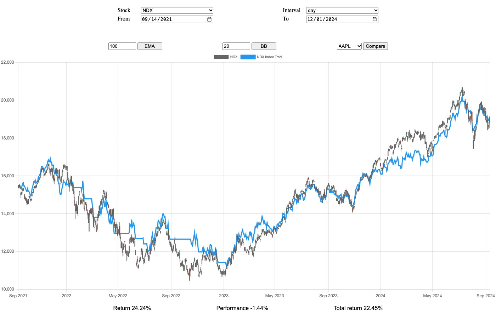

# stocks2.0

This is the first program I wrote. I built it in 2021–2022 to learn to code.
It is a browser app that backtests trading strategies on Nasdaq-100 (NDX) price history and charts the result against buy-and-hold.

The code is a learner's code. Most names, comments and messages are in Norwegian.



## What it does

- Charts NDX, AAPL, MSFT, GOOGL and TSLA as candlesticks, at 1-minute, daily or weekly intervals.
- Adds an exponential moving average (EMA), Bollinger Bands, or a second symbol to the chart.
- Runs a strategy over the selected date range and plots its equity curve on top of the price.
- Shows three numbers for each run:
  - **Return**: buy-and-hold return of the symbol over the range.
  - **Performance**: strategy result relative to buy-and-hold.
  - **Total return**: the strategy's own return.
- Prints the next action to the browser console, for example "sell if NDX falls below X".

## Strategies

All strategies use a trailing stop-loss with a buy-back rule:

1. While invested, sell when the price falls a set percentage below the highest close of the last few days.
2. After a sale, wait a cooldown period. Buy back early if the price goes above the recent high.
3. Otherwise, buy back when the price rises a set percentage above a recent low.

The daily strategy has three parameter sets: one for normal markets, one for recessions and one for high volatility.
Each day it measures the index's recent mean daily return and volatility. It then uses the parameter set that is closest to those values.
The intraday variants use one parameter set.

The buttons under the chart run these variants:

| Button | What it runs |
| --- | --- |
| Index Trad | Gets signals from NDX daily data. Finds the exact minute of each trade in the 1-minute data. Applies the trades to the selected symbol. |
| Index Day Trad | Same as Index Trad, but it executes on 1-minute bars and can trade more than once a day. |
| Day trad | Runs the strategy on the selected symbol. Also buys dips: it buys when the price opens 4% below, or falls 6% below, the lower Bollinger Band. |
| Trad trending stock | Uses NDX signals. On each buy, it picks the stock among AAPL, MSFT and GOOGL with the best volatility-adjusted return over the last 24 trading days. |

`scripts/kombinatorikk.js` contains the grid searches I used to tune the strategy parameters.

## Data

Prices come from the [Twelve Data](https://twelvedata.com/) time-series API. They are stored in `filer_new/` as JSON Lines, with one file for each interval and symbol (for example `1dayNDX.jsonl`).

The repository includes data up to 11 September 2024:

| Interval | Coverage |
| --- | --- |
| 1week | NDX from 1985 |
| 1day | NDX, AAPL and MSFT from 1990. GOOGL and TSLA from listing. |
| 1min | All five symbols from March 2020 |

The update script finds the last stored date for each file. It fetches newer bars, removes duplicates, and appends them. It also detects likely stock splits and asks before it adjusts older prices.

## Run the backtester

You need Python 3, or any other static file server. The stored data is enough to run every strategy.

```sh
git clone https://github.com/MatsNissen-Lie/stocks2.0.git
cd stocks2.0
python3 -m http.server 5501
```

Open <http://localhost:5501>. The page loads NDX daily data from September 2021 and runs **Index Trad**.
Change the symbol, interval or dates, then click a strategy button.

Serve the files from the repository root. The page reads data with `fetch()`, so opening `index.html` directly from disk does not work.

## Update the data

> Not verified. This command needs an interactive terminal and a Twelve Data API key.

You need Node.js.

```sh
npm install
node scripts/data.js
```

The script asks before it fetches new data. It uses the keys in the `API_keys` list in `scripts/data.js`. Replace them with your own Twelve Data key.
To change which symbols and intervals it updates, edit `focuz` and `valgte_intervaller` near the end of the same file.

## Project layout

```text
index.html                  Page layout and controls
css/index.css               Styles
scripts/
  data.js                   Node: fetches and updates price data from Twelve Data
  storage.js                Node: reads and appends the JSON Lines data files
  get_data.js               Browser: loads a symbol and date range from filer_new/
  globalefunksjoner.js      Shared helpers: date search, slicing, US market hours
  algo.js                   Indicators (EMA, Bollinger Bands, volatility), backtest engine, stock picker
  strategier.js             Strategy parameter sets
  kombinatorikk.js          Grid search over strategy parameters
  html.js                   Button handlers and result display
  localChart.js             Chart.js datasets and rendering
  extention-chartjs-chart-finacial.js   Vendored chartjs-chart-financial (MIT) for candlesticks
filer_new/                  Price data (JSON Lines)
docs/screenshot.png         Screenshot for this README
```

## Limitations

- I tuned the strategy parameters on the same history that the backtester replays. The results are in-sample.
- The backtest does not include brokerage fees, spreads or taxes.
- Known bugs, kept as they were when I stopped working on it:
  - **Trad trending stock** stops with an error before it shows its result.
  - The grid search in `kombinatorikk.js` reads `.portfølje`, but the backtest returns `.portfolio`.
- The **My Transactions** button showed my own brokerage trades. Those files are not in this repository, so the button shows nothing.

## Licence

MIT. See [LICENSE](LICENSE).
